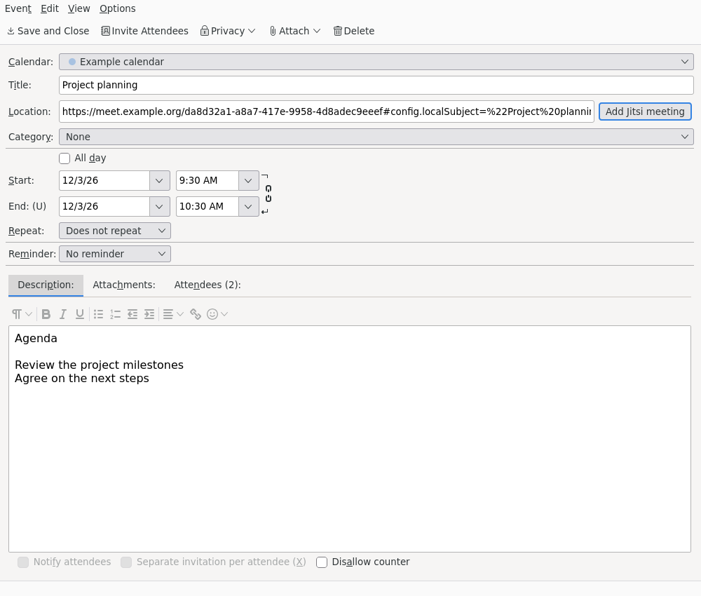
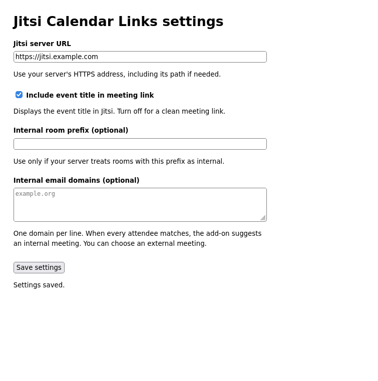

# Jitsi Calendar Links

Create a Jitsi meeting directly in Thunderbird's calendar event editor, using
your own server.



Click **Add Jitsi meeting** next to **Location**. Each room uses a cryptographically
random UUID, and the link can carry the calendar event's title as Jitsi's display
title. Existing rooms are reused; the button also refreshes their display title.
Save and send the event using Thunderbird's usual controls.

## Install and configure

Requires Thunderbird 153 or later. Download the XPI from the
[latest GitHub release](https://github.com/dcentralize/thunderbird-jitsi/releases/latest),
then install it through **Add-ons and Themes → Install Add-on From File**.
Subsequent versions use Thunderbird's native automatic updates.

Open the add-on's settings and enter your Jitsi server's HTTPS address. A server
path is supported. Server and domain settings start empty.



**Include event title in meeting link** shows the calendar title in Jitsi and is
enabled by default. Turn it off for a clean URL containing only the random room
name. It does not change the calendar event's title.

Optionally configure an internal room prefix and internal email domains. When
every attendee matches those domains, the button offers an internal meeting as
a recommendation; you can choose an external meeting.

The calendar button uses a Thunderbird Experiment API, which requires the
full-access permission at installation.

## Jitsi server

Use an HTTPS Jitsi Meet server reachable by invitees. The add-on generates links
locally and needs no server API key or extra Jitsi plugin.

Optional event-title display requires the Jitsi client to accept
`config.localSubject` URL overrides. Sign-in redirects must preserve the URL
fragment.

For guest meetings, enable the pre-join screen (`prejoinConfig.enabled`) and
configure a lobby for admission control. See Jitsi's
[authentication guide](https://jitsi.github.io/handbook/docs/devops-guide/authentication/)
for host and guest access. These controls are configured on the server.

Use an internal room prefix only when the server administrator provides one and
enforces its access rules. A prefix alone does not restrict who can join.

## Build and test

Build the XPI with the standard ZIP utility:

```sh
rm -f thunderbird-jitsi.xpi
zip -q thunderbird-jitsi.xpi manifest.json LICENSE background.js \
  experiment/schema.json experiment/api.js options/options.html options/options.js
```

The [GitHub workflow](.github/workflows/test.yml) lists the Linux dependencies and
pinned tool versions. Run the GUI test against an installed Thunderbird with
`uv` and Xvfb:

```sh
xvfb-run -a uv run --locked --script tests/calendar_editor.py \
  --binary /path/to/thunderbird --addon "$PWD/thunderbird-jitsi.xpi"
```

Tests use disposable profiles, local calendars and synthetic attendees.

## Releases

Push a `vVERSION` tag matching `manifest.json` to run the GitHub workflow. Download
the successful run's `thunderbird-jitsi` artifact and publish its XPI and
`updates.json` together in the corresponding
[GitHub release](https://github.com/dcentralize/thunderbird-jitsi/releases).
Thunderbird follows this repository's latest release for updates.

Licensed under the [MIT License](LICENSE).
